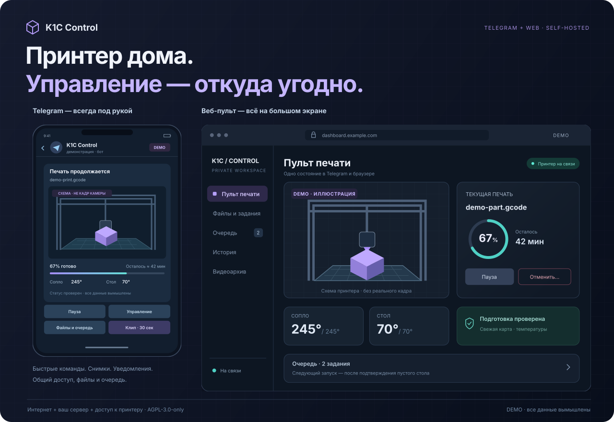
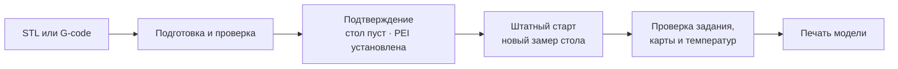
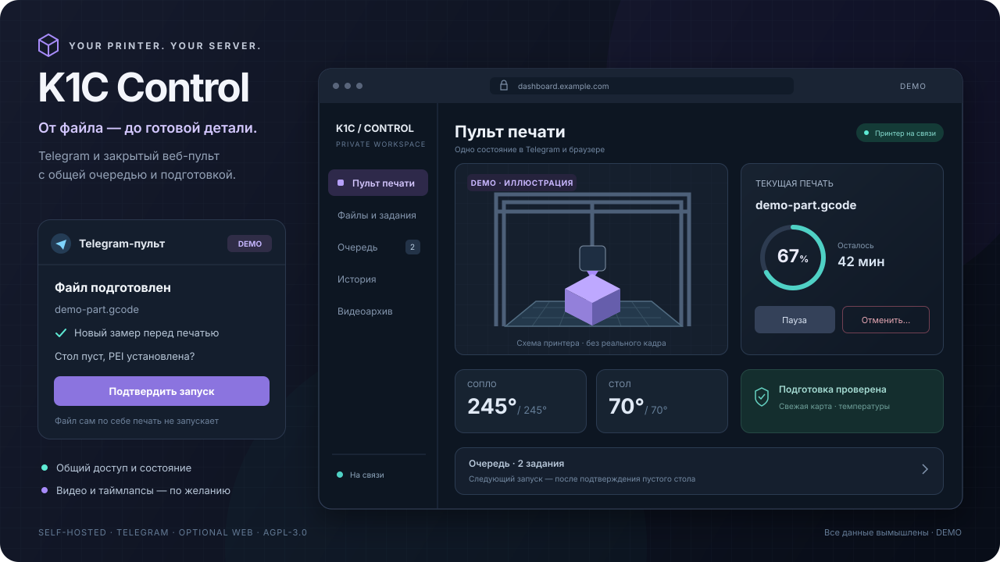
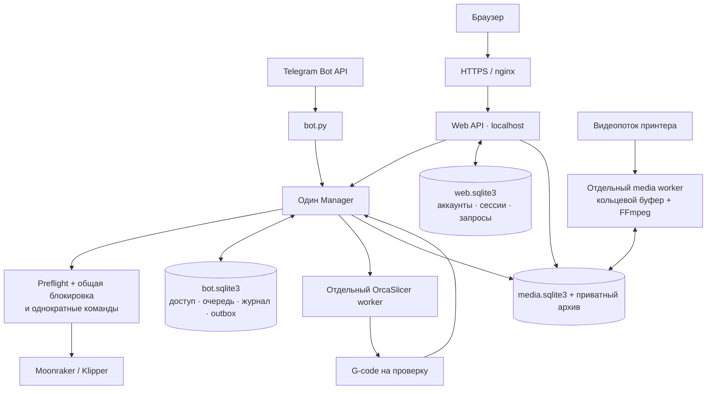

<div align="center">

# K1C Control

**Принтер дома. Управление — откуда угодно.**  
Telegram-бот и веб-пульт для Creality K1C.  
*Self-hosted printer control through Telegram and a private web dashboard.*


<br><br>



**[Возможности](#что-умеет)** · **[Быстрый старт](#быстрый-старт)** · **[Архитектура](#как-это-устроено)** · **[Развёртывание](#развёртывание)** · **[Лицензия](#лицензия)**

</div>

Проверить печать по дороге, получить уведомление о проблеме, отправить модель со смартфона или сохранить последние 30 секунд. **K1C Control даёт два пульта для вашего K1C: Telegram и закрытый сайт**, с общими файлами, очередью, допуском и подготовкой перед запуском.

Для доступа из любой точки нужны интернет на телефоне и сервере, а также соединение сервера с Moonraker принтера — например, через VPN. Можно развернуть **бота и сайт вместе** или пользоваться **только ботом**. Публичного сервиса, обязательной подписки и регистрации у автора нет.

### Когда принтер не рядом

- **«Как там деталь?»** — статус, температуры, оставшееся время и камера в Telegram или браузере.
- **«Нужно вмешаться».** — уведомление о событии, пауза или подтверждаемая отмена текущего задания.
- **«Следующая модель уже готова».** — отправить STL или G-code, подготовить его и оставить в общей очереди.
- **«Покажи, что было только что».** — запросить последние 30 секунд активной печати и получить клип в чате или архиве сайта.

Перед новым запуском нужно физически освободить стол и подтвердить установленную PEI-пластину. Дистанционный пульт помогает наблюдать и действовать; он не заменяет проверку принтера и места печати.

## Что умеет

| Возможность | Как работает |
| --- | --- |
| **Telegram-пульт** | Статус, температуры, камера, свет, пауза, продолжение и подтверждаемая отмена. Карточки обновляются на месте. |
| **Общий доступ** | Владелец одобряет заявки, отзывает доступ и блокирует пользователей. Telegram и сайт используют один список допуска. |
| **STL → G-code** | Отдельный сервис OrcaSlicer подготавливает STL по доверенному PETG-профилю, загружает результат и проверяет его перед предложением запуска. |
| **Подготовка перед печатью** | Штатный старт с `NEEDCALIBRATE=1`, новый адаптивный замер и служебная остановка до модели. После сбоя автоматического продолжения нет. |
| **Файлы и очередь** | Импорт готового G-code, повторная подготовка, параметры STL, ручной переход к следующему заданию и история действий. |
| **Веб-пульт** | Пульт, файлы, очередь, история и видеоархив. Отдельные логины, общие права с ботом, HTTPS, CSRF и отзыв действующих сессий. |
| **Видео — по желанию** | Клип последних **30 секунд** по запросу; можно выбрать 1–300 секунд. После завершения задания — ускоренный таймлапс. |
| **Ограниченный архив** | Хранение **7 дней**, максимум **10 GiB**. При заполнении новые записи приостанавливаются; владелец может удалить старые вручную. |
| **Локальный контроль брака — по желанию** | Интеграция Obico ONNX, последовательная оценка наблюдений и тревоги. Автопауза включается владельцем отдельно. |

### Несколько команд вместо длинного меню

```text
/status       Прогресс, время и температуры
/temperature  Нагрев сопла и стола
/files        Файлы и подготовка к печати
/queue        Очередь с ручным запуском
/print        Управление текущим заданием
/video 30     Последние 30 секунд печати
/history      История заданий и действий
/admin        Допуск пользователей — для владельца
```

Снимок камеры доступен через `/photo`, свет — через `/light`. Бот также понимает простые запросы вроде «что печатается» и «сколько осталось». Физические команды выполняются по явным командам и кнопкам.

## Как проходит запуск



Готовый G-code сохраняет свои температурные команды. Для STL температуры можно изменить до запуска: модель будет подготовлена заново, а старое подтверждение потеряет силу. Если температуру стола меняют во время подготовки, модель остаётся на остановке до прогрева и нового замера.

Статус отображается из быстрого кеша с отметкой актуальности. Управляющие действия используют свежие проверки. Перед физической командой сохраняется её однократная заявка: неопределённый сетевой результат не вызывает автоматическую повторную отправку.

## Быстрый старт

**Впервые устанавливаете? [Полная пошаговая инструкция: от BotFather до systemd, HTTPS и видео →](docs/SETUP.md)**

Понадобятся **Python 3.9+**, Telegram-бот и доступ к совместимому Moonraker. Основной Python-код использует стандартную библиотеку. OrcaSlicer, FFmpeg и сервис детектора нужны только для соответствующих дополнительных функций.

### 1. Подготовить конфигурацию

```bash
cp config.example.json config.json
chmod 600 config.json
```

Заполните локальный `config.json`:

| Ключ | Что указать |
| --- | --- |
| `owner_id` | Свой числовой Telegram ID. Это владелец, управляющий общим доступом. |
| `bot_token` | Токен вашего бота. |
| `printer_url` | Доступный серверу URL Moonraker, например `http://printer.local:7126`. |
| `snapshot_url` | URL JPEG-снимка вашей камеры, если используете фото или детектор. |
| `allowed_user_ids` | Необязательный начальный список допуска. Дальнейшие изменения хранятся в SQLite. |

Секретную конфигурацию, базы, загруженные модели и видеозаписи не добавляют в Git. В примере веб-панель, запись видео и автоматические реакции выключены.

### 2. Запустить бота

```bash
python3 bot.py --config config.json --check-config
python3 bot.py --config config.json --state-dir ./state
```

`--check-config` проверяет локальные настройки без сети и создания состояния. Нулевой `owner_id` и заглушку токена в примере нужно заменить до запуска.

Напишите боту `/start` в личном чате. Владелец получает административное меню; другие пользователи могут запросить доступ. Получение файла само по себе печать не начинает.

### 3. Добавлять возможности по необходимости

| Нужно | С чего начать |
| --- | --- |
| Подготовка STL | [Сервис OrcaSlicer](SLICER_README.txt): отдельный ключ, фиксированные профили и один процесс нарезки. |
| Веб-пульт | [Веб-панель и видео](docs/README/web-and-media.md): HTTPS-прокси и индивидуальные учётные записи. |
| Видео и таймлапсы | FFmpeg/ffprobe и отдельный media worker; источник и запись включаются явно. |
| Детектор | [Локальный Obico](ai/README.txt) и [происхождение оценки](SCORING_README.txt). Сначала проверьте наблюдения на своей установке. |

Бот работает самостоятельно. Веб-панель можно включить вместе с ним: она использует тот же контроллер и состояние, без второго независимого пути запуска печати.

## Telegram и сайт — одна система

Telegram удобен для быстрых команд и уведомлений. В браузере доступны полный пульт, файлы, очередь, история, видеоархив и управление пользователями. Аккаунты создаёт владелец. Оба интерфейса используют один контроллер: действие из чата сразу относится к тому же заданию, что и действие на сайте.

<details>
<summary>Посмотреть демонстрационную схему веб-пульта</summary>



</details>

Подключение: [веб-панель и видео](docs/README/web-and-media.md).

## Как это устроено



Веб-API слушает только `127.0.0.1:3340`; TLS завершает reverse proxy. Приватное видео выдаёт приложение после проверки доступа, включая HTTP Range. nginx не публикует каталог архива напрямую. Media worker хранит собственное состояние и не отправляет команды движения или запуска принтеру.

## Развёртывание

[Материалы в `deploy/`](deploy/README.txt) содержат шаблоны systemd, nginx и TLS. Они требуют адаптации под сервер: адрес, маршруты до принтера, пути, учётную запись и ограничения ресурсов. Это не универсальный установщик одним запуском.

Для существующей установки перед миграцией делают согласованную резервную копию SQLite. Скрипт переключения проверяет сохранность доступа и очереди; откат восстанавливает код и конфигурацию, сохраняя актуальные данные. Веб-панель и запись видео включаются отдельно.

## Проверки и CI

```bash
python3 -m unittest discover -p 'test_*.py' -v
python3 -m unittest discover -s deploy -p 'test_*.py' -v
```

Тесты используют временные базы, локальные HTTP-серверы и подставной принтер. Синтетические проверки FFmpeg выполняются при наличии `ffmpeg` и `ffprobe`; реальные снимки не нужны. [Workflow в `.github/workflows/`](.github/workflows/) запускает проверки публичного экспорта. Значки в начале README описывают стек и не выдают себя за результат CI.

Покрываются права и отзыв сессий, подтверждения, перезапуски, неопределённый результат физических запросов, очередь подготовки, калибровка, загрузки, видео и ограничения архива.

## Совместимость и ограничения

- Проверенная аппаратная ветка — **Creality K1C 2025**, прошивка **`V1.0.0.24`**. Другие версии Klipper и фирменных макросов требуют отдельной проверки.
- Подготовка рассчитана на штатный `START_PRINT` и проверяемые границы модели. Произвольный G-code может быть отклонён; 3MF подготавливается отдельно в OrcaSlicer.
- Через сайт принимаются STL до **20 MiB** и G-code до **128 MiB**. Прямая загрузка боту ограничена возможностями Telegram Bot API.
- STL считается в миллиметрах. Автомасштабирования нет; автоориентация не гарантирует нужную прочность и лицевую сторону детали.
- Клип требует свежего уникального ID активного задания и доступного буфера. Пропуски и неполная запись отмечаются в метаданных, отсутствующие кадры не восстанавливаются.
- Оценка детектора не является вероятностью исправной печати. Сложная геометрия, ракурс и прозрачный материал могут давать ложные сигналы или пропуски.
- Переключение питания требует отдельного драйвера розетки. Отсутствующее устройство не изображается работающим; автоматического выключения после печати нет.

## Лицензия

Проект распространяется под **[GNU AGPL-3.0-only](LICENSE)**. В нём используется производный модуль временной оценки Obico; исходная атрибуция и текст лицензии сохранены. HLS.js поставляется под Apache License 2.0 со своими уведомлениями об авторских правах. Подробности и первичные источники — в [NOTICE](NOTICE).

При изменении и распространении, в том числе предоставлении изменённой версии по сети, соблюдайте условия AGPL. Бинарники OrcaSlicer, FFmpeg и веса модели не включены в репозиторий; их условия использования рассматриваются отдельно.
